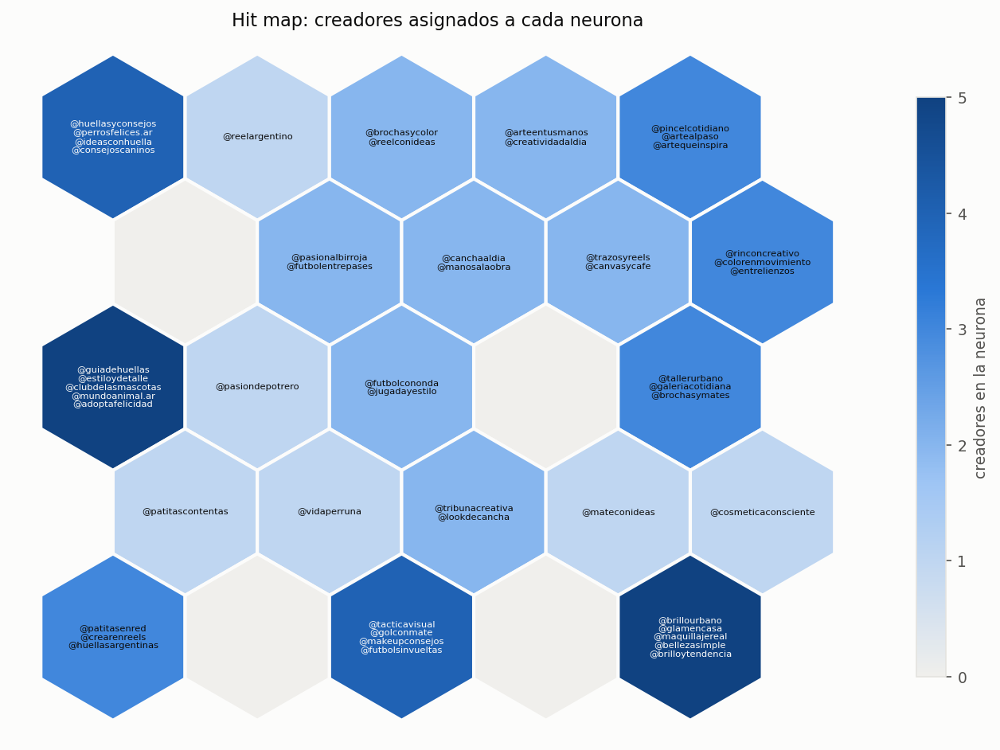
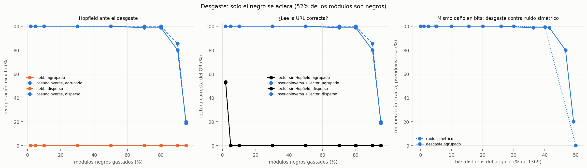
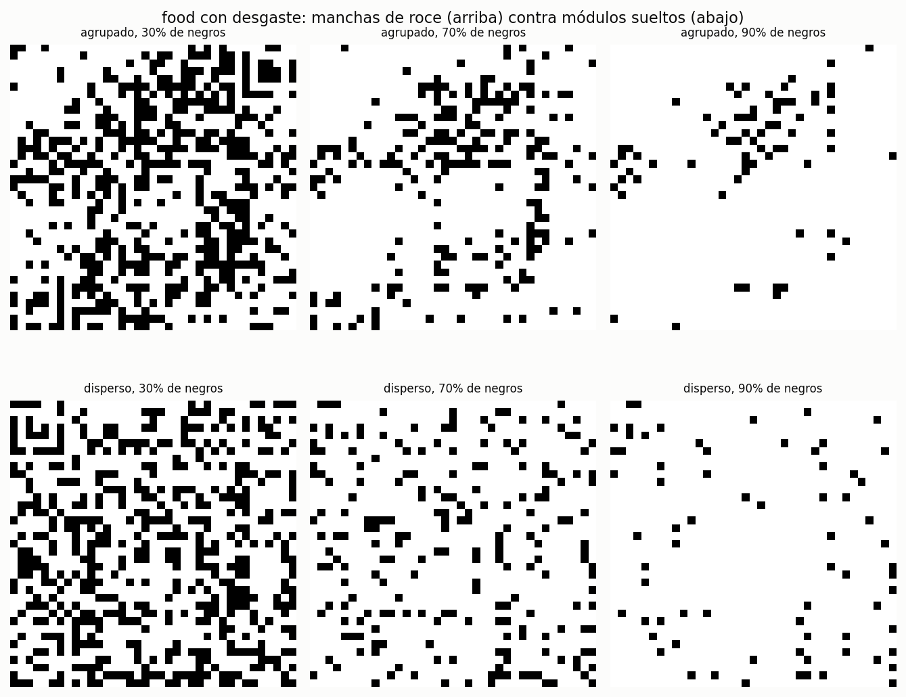

# TP4 · Métodos de aprendizaje no supervisado

**README principal del TP4 de Sistemas de Inteligencia Artificial.** Reúne la preparación,
los experimentos, las decisiones y todas las conclusiones de los dos ejercicios. Los CSV,
modelos y gráficos que respaldan los resultados están en `resultados/`.

En el ejercicio 1 se reducen las variables de 50 creadores a 15 con análisis de correlación y
PCA, y se usan Kohonen y Oja para fundamentar decisiones de campañas. En el ejercicio 2 se implementa memoria asociativa con Hopfield para letras
5×5 y cinco QR 37×37. Hebb es el caso clásico evaluado; la pseudoinversa se presenta como
**extensión opcional**, no exigida explícitamente por el enunciado ni sustituto de su análisis.

## Contenido

- [Instalación y ejecución](#ejecucion)
- [Ejercicio 1: creadores y campañas](#ejercicio-1)
- [Ejercicio 2: memoria asociativa](#ejercicio-2)
- [Verificación](#verificacion)
- [Conclusiones generales](#conclusiones-generales)
- [Archivos y documentación de respaldo](#archivos)

<a id="ejecucion"></a>

## Instalación y ejecución

Los comandos se ejecutan desde `TP4/`. Se utilizó Python 3.10 con un entorno virtual.
Los modelos se implementan con NumPy; pandas y Matplotlib se usan para datos y gráficos.
ZXing-C++ se usa únicamente como lector para verificar el texto de los QR.

```bash
python3 -m venv .venv
source .venv/bin/activate
python -m pip install -r requirements-qr.txt
```

`requirements-qr.txt` incluye las dependencias de `requirements.txt`, Pillow y ZXing-C++.
Para ejecutar solo el ejercicio 1 y las letras alcanza con `requirements.txt`.

| Parte | Comando | Salidas |
|---|---|---|
| Selección de 15 variables | `python seleccion.py` | `resultados/seleccion/` |
| EDA y PCA | `python exploracion.py` | `resultados/exploracion/` |
| Kohonen: barridos y modelo final | `python agrupamiento.py` | `resultados/kohonen/` |
| Oja: convergencia e índice final | `python indice.py` | `resultados/oja/` |
| Hopfield con letras | `python letras.py` | `resultados/hopfield/letras/` |
| Hopfield con QR | `OPENBLAS_NUM_THREADS=1 python qr.py` | `resultados/hopfield/qr/` |

Para regenerar solo los resultados finales del ejercicio 1:

```bash
python agrupamiento.py final
python indice.py final
```

Los modos `python agrupamiento.py barridos` y `python indice.py convergencia` ejecutan
solo sus respectivos experimentos. Los scripts regeneran CSV, gráficos y modelos en disco;
no abren ventanas ni modifican automáticamente los informes Markdown. Las imágenes existentes
se pueden abrir directamente sin volver a entrenar. `OPENBLAS_NUM_THREADS=1` evita sobrecosto
de hilos en los cálculos repetidos de QR y no modifica la regla de recuperación.

<a id="ejercicio-1"></a>

## Ejercicio 1 · Selección de creadores para campañas

El objetivo es elegir creadores por su perfil comercial, audiencia y contenido, además de
la cantidad de seguidores. Se consideran refugios de perros, ropa de fútbol, belleza y
materiales de arte. Los métodos describen perfiles; el dataset no contiene ventas ni
adopciones para demostrar rentabilidad.

### 1.1 Exploración, reducción a 15 variables y PCA

Los 50 registros no tienen faltantes. Se excluyen `creator_id` y `name` del entrenamiento:
son identificadores, no características del perfil. Quedan 31 variables numéricas con
escalas muy distintas (seguidores en cientos de miles, porcentajes, tasas por mil), por lo
que todo el análisis usa z-score con media y desvío poblacional por columna.

Muchas de esas 31 variables **no aportan información propia**: son fórmulas de otras, copias
casi exactas de otras o ruido. Si entran al entrenamiento, multiplican el peso de un mismo
concepto en las distancias del SOM y en la covarianza de PCA y Oja. Por eso se reduce el
conjunto a **15 variables** con un procedimiento reproducible de cuatro etapas
(`python seleccion.py`). Las variables descartadas siguen en el DataFrame para interpretar
(por ejemplo, `followers` para comparar con la estrategia actual y `price_usd` para el costo).

Fuente: [etapas](resultados/seleccion/etapas.csv), [test de ruido](resultados/seleccion/ruido.csv),
[comparación de estrategias](resultados/seleccion/comparacion.csv),
[gráfico de comparación](resultados/seleccion/comparacion.png),
[correlaciones de todas](resultados/exploracion/correlaciones.png) (en rojo, las descartadas) y
[correlaciones de las 15](resultados/seleccion/correlaciones_seleccionadas.png).

#### Etapas de la reducción (31 → 15)

| Etapa | Criterio | Descartadas | Quedan |
|---|---|---|---:|
| 1. Derivadas | Se calculan exactamente a partir de otras columnas. | `price_ars` (= USD × 1500), `organic_posts_pct` (= 100 − patrocinados), `total_engagement_per_1000` (suma de las cuatro tasas), `estimated_argentina_reach` (alcance × % argentino) | 27 |
| 2. Ruido | Test de permutación (2000 permutaciones): ¿la mayor \|r\| de la variable con las demás supera lo esperable por azar? | `monthly_posts`: máx. \|r\| = 0,29, p = 0,45 y η² con el tema = 0,00. No se relaciona con ninguna otra variable ni con el tema. | 26 |
| 3. Correlación | Bloques conexos con \|r\| ≥ 0,9; se conserva la variable más central del bloque. | Tamaño: `average_impressions` (0,987), `average_video_views` (0,997), `followers` (0,918) y `price_usd` (0,907), representados por `average_reach`. Formato: `video_posts_pct` (0,971), `trend_posts_pct` (0,961) y `likes_per_1000` (0,901), representados por `short_form_posts_pct`. | 19 |
| 4. PCA hacia atrás | Jolliffe B2: se toma la componente de menor autovalor y se descarta la variable de mayor \|coeficiente\| en ella; se repite. | `content_entertainment_pct` (autovalor 0: los cuatro formatos suman 100), `average_caption_words` (PC17, λ = 0,054, coef. +0,71), `short_form_posts_pct` (PC16, λ = 0,069, coef. +0,77), `content_review_pct` (PC15, λ = 0,128, coef. +0,54) | **15** |

La lógica de la etapa 4 es que una componente con autovalor casi nulo es una combinación
lineal de variables que casi no varía: una de ellas se puede reconstruir con las demás.
La variable que más pesa en esa dirección es la más redundante. Por ejemplo, las palabras por
caption tienen r = −0,86 con el alcance y +0,82 con los guardados: lo que dicen ya está en
las otras variables de "tamaño" y "profundidad". `short_form_posts_pct`, el representante del
bloque de formato, también resulta redundante cuando ya están alcance, shares y alcance a no
seguidores (r = 0,72–0,79).

Dos supuestos se declaran explícitamente:

- **Los cuatro temas se protegen en todas las etapas.** Definen a los cuatro clientes. Suman
  100, así que uno es redundante en sentido lineal, y por eso los métodos puramente numéricos
  descartan uno. Pero quitar, por ejemplo, `topic_art_pct` convertiría arte en el "origen"
  de las coordenadas: un creador de arte puro quedaría a menor distancia de los demás que
  cualquier otro par de temas. Con los cuatro, las distancias entre temas puros son simétricas.
  El costo es un autovalor nulo en la PCA de las 15.
- **`argentina_audience_pct` se conserva aunque el test la marque como ruido** (máx. \|r\| = 0,30,
  p = 0,37). Que no correlacione con nada significa que es información **única**: ninguna otra
  variable mide si la audiencia es local. Se asume que los clientes venden y gestionan
  adopciones en Argentina (el precio también está en ARS). En cambio, la frecuencia mensual
  no cambia lo que entrega una publicación patrocinada (que ya está medido por alcance y tasas)
  y no tiene relación con el tema: se descarta.

**Variables seleccionadas (15):**

| Dimensión | Variables |
|---|---|
| Tamaño y descubrimiento | `average_reach`, `non_follower_reach_pct`, `shares_per_1000` |
| Profundidad e interacción | `comments_per_1000`, `saves_per_1000`, `profile_visits_per_1000`, `average_watch_time_seconds` |
| Audiencia y perfil comercial | `argentina_audience_pct`, `sponsored_posts_pct` |
| Temática | `topic_football_pct`, `topic_makeup_pct`, `topic_dogs_pct`, `topic_art_pct` |
| Tipo de contenido | `content_tutorial_pct`, `content_showcase_pct` |

Cubren los tres ejes que pregunta la consigna para fútbol: alcance masivo (`average_reach`),
descubrimiento (`non_follower_reach_pct`) y profundidad educativa (`content_tutorial_pct`,
guardados). La mayor correlación entre ellas baja de 0,997 a 0,74.

#### Iteración: comparación con otras estrategias

Se compararon seis maneras de llegar a 15 variables y el conjunto completo de 27. Criterios:

- **Varianza retenida**: fracción de la varianza total de las 27 que se reconstruye por
  regresión lineal desde las 15 (criterio de Cadima y Jolliffe).
- **R² de PC1–PC6**: qué tan bien se reconstruyen las seis primeras componentes de las 27.
- **η² de tema**: mayor fracción de varianza de una de las PC1–PC4 que explica el tema
  dominante (¿la PCA de las 15 "ve" a los clientes?).
- **Pureza de tema en el SOM**: con la configuración final del 1.2 y 5 semillas, fracción de
  creadores cuyo tema coincide con el mayoritario de su neurona. Es la prueba de uso: si la
  reducción ayuda a que el mapa separe los perfiles que importan.

| Estrategia | Varianza retenida | R² PC1–6 | máx. \|r\| | Kaiser (var.) | η² tema | Pureza SOM | Problema |
|---|---:|---:|---:|---|---:|---:|---|
| Todas (27) | 1,000 | 1,000 | 0,997 | 6 (81,1 %) | 0,56 | 0,844 | bloques redundantes y ruido |
| **Elegida** | 0,929 | 0,968 | 0,742 | 5 (75,2 %) | **0,81** | **0,952** | — |
| PCA atrás (B2) puro | 0,948 | 0,976 | 0,689 | 4 (66,9 %) | 0,52 | 0,852 | quita alcance, descubrimiento y un tema; conserva ruido |
| PCA atrás, temas fijos | 0,936 | 0,974 | 0,689 | 5 (73,1 %) | 0,66 | 0,932 | quita alcance; conserva ruido |
| PCA adelante (B4) | 0,928 | 0,960 | 0,823 | 4 (67,6 %) | 0,51 | 0,836 | quita alcance y un tema; conserva ruido |
| Máx. varianza | 0,964 | 0,995 | 0,839 | 4 (71,1 %) | 0,61 | 0,868 | quita descubrimiento y un tema; conserva ruido |
| Máx. varianza, temas fijos | 0,952 | 0,993 | 0,839 | 5 (76,1 %) | 0,64 | 0,908 | quita descubrimiento y guardados; conserva ruido |

Lecturas:

- **En información lineal todas las estrategias empatan.** Retienen entre 93 % y 96 % de la
  varianza de las 27 y reconstruyen más del 96 % de sus seis primeras componentes. Entre los
  1365 subconjuntos de 15 que contienen los cuatro temas y salen de la etapa 3, la varianza
  retenida va de 0,850 a 0,938; la elección está en 0,929, en la meseta superior.
- **Los criterios puramente numéricos premian el ruido.** Una variable independiente de todas
  solo se "explica" incluyéndola, así que maximizar varianza o aplicar B2 sin filtro conserva
  siempre `monthly_posts`. Lo mismo infla el criterio de Kaiser: en las 27, las mayores cargas
  de PC5 eran frecuencia mensual (+0,57) y audiencia argentina (−0,56), dos variables sin
  relación con el resto.
- **También eliminan ejes de negocio.** B2 y B4 descartan `average_reach` porque se reconstruye
  con captions, comentarios y guardados; la máxima varianza descarta `non_follower_reach_pct`.
  Sin ellos no se puede responder la pregunta de alcance masivo contra descubrimiento.
- **La elección es la que mejor separa a los clientes.** Con las 27, los bloques de tamaño
  (5 variables con r ≥ 0,9) y formato (4) dominan las distancias y el tema queda diluido:
  las neuronas del SOM agrupan el tema mayoritario en el 84 % de los casos. Con las 15
  elegidas, el 95 %. El error de cuantización por dimensión es similar (0,58 contra 0,61),
  así que la mejora no es a costa de ajustar peor.

#### PCA sobre las 15 variables

Fuente: [varianza](resultados/exploracion/pca_varianza.csv), [scree plot](resultados/exploracion/scree.png),
[cargas](resultados/exploracion/pca_cargas.csv) y [biplot](resultados/exploracion/biplot.png).
Las cargas indicadas son correlaciones variable–componente, no coeficientes del autovector.

| Componente | Varianza | Lectura de las cargas principales |
|---|---:|---|
| PC1 | 36,5 % | **Masivo ↔ profundo.** Alcance +0,88, alcance a no seguidores +0,74, shares +0,64; frente a visitas al perfil −0,83, guardados −0,83, comentarios −0,79, tutoriales −0,76, watch time −0,74 y perros −0,57. |
| PC2 | 12,9 % | **Comercial ↔ local.** Patrocinio +0,69, showcase +0,52, fútbol +0,45, arte +0,41; frente a audiencia argentina −0,57 y perros −0,55. |
| PC3 | 10,1 % | **Fútbol ↔ arte.** Fútbol +0,77 frente a arte −0,68 y showcase −0,41. |
| PC4 | 9,0 % | **Maquillaje.** Maquillaje +0,83 frente a arte −0,41. |
| PC5 | 6,7 % | Audiencia argentina +0,59 y arte +0,37 frente a showcase −0,35 y perros −0,32. |

Con las 27 variables PC1 explicaba 49,7 %, pero buena parte de eso era el mismo concepto
contado cinco veces (seguidores, alcance, impresiones, vistas, precio). Con las 15, PC1 baja a
36,5 % y aparecen componentes que separan temas: PC3 y PC4 son ejes de cliente, y el tema
explica el 81 % de la varianza de PC3. PC1 sigue correlacionando 0,85 con `followers` aunque
`followers` no entró en la PCA.

**Decisión:** la reducción de dimensionalidad que se usa es la **selección de 15 variables
originales**; Kohonen y Oja se entrenan con ellas estandarizadas. Se prefirió a entrenar sobre
las componentes principales porque cada peso del SOM sigue siendo interpretable como una
variable del negocio, y un creador nuevo solo necesita esas 15 columnas. PC1–PC2 (49,5 %) se
usan para visualizar; Kaiser retiene 5 componentes (75,2 %). Una cercanía en el biplot no
garantiza cercanía en las 15 variables: la mitad de la varianza queda fuera de ese plano.

### 1.2 Kohonen: elección e interpretación

Fuente: [barridos](resultados/kohonen/barridos.csv), [hit map](resultados/kohonen/hit_map.png),
[matriz U](resultados/kohonen/u_matrix.png), [planos](resultados/kohonen/component_planes.png),
[perfiles](resultados/kohonen/perfiles_neuronas.csv) y [grilla en PCA](resultados/kohonen/grilla_en_pca.png).

Se adopta una grilla hexagonal **5 × 5**, inicialización con muestras, 500 épocas,
η lineal 0,5 → 0,01 y radio lineal 3 → 1. El barrido cambia un parámetro por vez con cinco
semillas; no es una búsqueda exhaustiva de interacciones. Los errores se calculan sobre los
mismos datos de entrenamiento y describen representación y topología, no rendimiento comercial.

| Variante | Error de cuantización medio | Error topográfico medio | Neuronas sin asignaciones, media |
|---|---:|---:|---:|
| k = 3 | 2,891 | 0 | 0 de 9 |
| k = 5, configuración elegida | 2,346 | 0 | 5,0 de 25 |
| k = 8 | 1,685 | 0 | 30,0 de 64 |
| k = 5, radio final 0 | 1,512 | 0,204 | 1,4 de 25 |

Una grilla mayor reduce el error pero introduce muchas celdas vacías para solo 50 creadores.
El radio final 0 mejora el ajuste local a costa de perder continuidad entre primeras y segundas
BMU. Se prioriza el compromiso de k = 5 y radio final 1 para interpretar regiones vecinas.
Las medias de error varían poco con η inicial (2,346–2,384), inicialización (2,346 frente a
2,360) o 50–1000 épocas (2,346–2,377). Las 500 épocas son una elección conservadora dentro
de esa meseta; no se afirma que sean el único valor adecuado. Radio inicial 3 permite ordenar
la grilla primero y refinarla después. Los errores no son comparables con los de la versión
de 27 variables, porque la distancia euclídea crece con la cantidad de dimensiones.

Entre las cinco semillas de la configuración elegida se toma la de menor error de
cuantización: **EC = 2,331, ET = 0 y 4 neuronas vacías**. Una neurona vacía tiene pesos y
puede actuar como transición; no equivale a un grupo de creadores observado.

#### Regiones de la grilla

Cada neurona es un prototipo de 15 pesos, no una persona ni una etiqueta temática.
La BMU (*Best Matching Unit*) es el prototipo de menor distancia al creador. Durante el
entrenamiento se actualizan la BMU y sus vecinas hacia la muestra; al final se asigna cada
creador a su BMU. Las neuronas vecinas tienden a representar perfiles similares.

El **hit map** solo muestra cantidades y nombres: su azul no significa perros, fútbol ni
calidad. El mapa de temas permite identificar los temas predominantes y los planos de
variables permiten interpretar los pesos. Las regiones temáticas se identifican después de
entrenar, no se imponen como etiquetas a la red.



[Mapa por temas](resultados/kohonen/temas.png) ·
[Planos de variables](resultados/kohonen/component_planes.png)

Las coordenadas son `(fila, columna)`, desde 0, con fila 0 arriba. Su orientación corresponde
a este modelo; otra semilla puede rotar o reflejar el mapa sin cambiar su interpretación.
Los nombres de usuario no determinan el tema: por ejemplo, `@vidaperruna` tiene tema dominante
fútbol según sus porcentajes, y `@reelargentino`, maquillaje.

| Región | Perfil y ejemplos |
|---|---|
| Columna izquierda, arriba: (0,0), (2,0) | Perros profundos y locales: tutoriales, visitas al perfil, guardados, watch time y alta audiencia argentina; poco alcance y descubrimiento. `@huellasyconsejos`, `@consejoscaninos`, `@guiadehuellas`, `@adoptafelicidad`. |
| Columna izquierda, abajo: (3,0), (4,0) | Perros de mayor alcance y shares: `@patitascontentas`, `@patitasenred`, `@crearenreels`, `@huellasargentinas`. |
| Arriba centro: (0,1)–(0,2), (1,1)–(1,2), (2,1) | Fútbol y maquillaje educativos: comentarios, guardados, tutoriales y patrocinio. `@reelargentino`, `@brochasycolor`, `@futbolentrepases`, `@pasionalbirroja`, `@pasiondepotrero`. |
| Arriba derecha: (0,3)–(0,4), (1,3)–(1,4) | Arte con showcase: `@arteentusmanos`, `@pincelcotidiano`, `@artealpaso`, `@trazosyreels`, `@colorenmovimiento`. |
| Centro: (2,2), (2,4) | Transiciones: fútbol intermedio (`@futbolcononda`, `@jugadayestilo`) y arte/maquillaje con shares (`@galeriacotidiana`, `@tallerurbano`, `@brochasymates`). |
| Abajo centro: (3,1)–(3,2), (4,2) | Fútbol masivo y de descubrimiento: alcance, alcance a no seguidores y shares, pocos tutoriales. `@golconmate`, `@tacticavisual`, `@futbolsinvueltas`, `@tribunacreativa`. |
| Abajo derecha: (3,3)–(3,4), (4,4) | Maquillaje masivo: `@mateconideas`, `@brillourbano`, `@maquillajereal`, `@glamencasa`. |

Las filas siguen aproximadamente PC1: la proyección media de las neuronas va de −3,7 a −0,2
en la fila 0 (profundidad) y de 0,6 a 3,1 en la fila 4 (masividad). Las columnas separan
temas: perros a la izquierda, fútbol en el centro, arte y maquillaje a la derecha (arte
arriba, maquillaje abajo). Coincide con el biplot (PC1 horizontal, perros/audiencia local
abajo en PC2), pero el SOM usa también PC3–PC5, que separan fútbol, arte y maquillaje.
Solo 2 de 21 neuronas con creadores mezclan temas, frente a 6 en la versión de 27 variables.

#### Matriz U

Cada celda muestra la distancia euclídea media entre su vector de 15 pesos estandarizados
y los de sus vecinas adyacentes. Un valor alto señala una transición marcada de perfiles;
uno bajo, continuidad. No mide calidad, alcance ni rentabilidad del creador.

En el modelo guardado los valores van de **1,03 a 2,36**. La región de arte, (1,4) con U = 1,03
y (0,4) con 1,15, es la más homogénea. Los valores altos están en la columna de perros,
(3,0) con 2,36 y (4,0) con 2,24, donde el mapa pasa de perros a fútbol masivo, y en la fila
central, (2,1)–(2,3) con 1,98–2,03, que separa la mitad profunda de la masiva. Son fronteras
relativas, no una demostración de un número exacto de clusters ni un umbral automático de
separación.

### 1.3 Oja: índice de creadores

Una neurona lineal calcula `y = w·x` y aprende con `Δw = η y (x − y w)`.
Usa las mismas 15 variables estandarizadas, una permutación de los 50 creadores por época
y pesos iniciales aleatorios de norma 1. La configuración final es
`η(t) = 0,01 / (1 + t/50)`, 100 épocas y semilla 0. El signo se fija haciendo positivo el
peso de mayor módulo, igual que en PCA pero sin consultar su autovector.

Resultados de este apartado: [carpeta Oja](resultados/oja/),
[convergencia](resultados/oja/convergencia.png), [pesos](resultados/oja/pesos_vs_pc1.png)
y [gráficos del índice](resultados/oja/indice.png).

**Resumen:** la regla de Oja se aproxima a ‖w‖ = 1 y al autovector de PC1 (ángulo 0,06°,
diferencia máxima por peso 0,0005). El índice resultante **aproxima** la proyección sobre
PC1: mismo ranking en los 50 creadores. Representa el eje "alcance masivo y descubrimiento"
(índice alto) contra "audiencia chica pero profunda y comprometida" (índice bajo). **No**
sirve para elegir automáticamente al creador de mayor valor para cualquier campaña: es un
solo eje, reproduce en gran parte el orden por seguidores y deja afuera el tema.

---

#### Convergencia (`convergencia.png`, `convergencia_resumen.csv`)

Se mide, al final de cada época, ‖w‖ y el ángulo entre `w` y el autovector de PC1 (5 semillas).
La tabla muestra medias finales, salvo el máximo explícito. «Épocas hasta < 1°» es la media
del primer cruce entre semillas cuando las cinco lo alcanzan; no exige permanecer bajo 1°.
La corrida final con semilla 0 tiene un ángulo de 0,06°; la media de las cinco es 0,13°.

| η | ‖w‖ final | ángulo final con PC1 | épocas hasta < 1° | observación |
|---|---|---|---|---|
| 0,0001 | 1,0002 | 50° (máx. 89°) | nunca | demasiado lento en 100 épocas |
| 0,001 | 1,0022 | 0,32° (máx. 0,47°) | 34 | buen compromiso con η fijo |
| 0,01 | 1,022 | 7,9° (máx. 10,8°) | nunca | oscila alrededor de PC1 |
| 0,02 | 1,042 | 17° (máx. 22°) | nunca | oscila más |
| 0,05 | 1,109 | 33° (máx. 41°) | nunca | oscila mucho, sin diverger |
| **0,01 / (1 + t/50)** | **1,0003** | **0,13°** | **28** | rápido al principio, fino al final |

Lecturas:

- **La norma se acerca a 1 en las configuraciones estables probadas**: con ‖w₀‖ = 0,01 crece y con
  ‖w₀‖ = 10 decrece, y todas las curvas terminan cerca de 1 (con η = 0,001, 1,0022 en los cuatro
  casos). Esto no prueba convergencia desde cualquier inicialización: por ejemplo, w₀ = 0
  permanecería en cero. Es el término `− η y² w` de la regla el que hace de normalización implícita.
- **Con η fijo hay un compromiso.** η chico tarda: con 0,0001 el ángulo sigue en 50° tras 100
  épocas. η grande llega rápido pero no se queda quieto: cada muestra empuja a `w` en una
  dirección distinta y el vector oscila alrededor de PC1 con mayor ángulo al aumentar η
  (8° con 0,01, 17° con 0,02). La norma queda sesgada por encima de 1 (1,02 y 1,04).
- **Convergencia más lenta que con 27 variables.** El autovalor de PC1 bajó de 13,4 a 5,5 y
  la brecha con PC2 (λ₂ = 1,9) es menor en términos absolutos: la regla promedio "tira" hacia
  PC1 con menos fuerza, así que hacen falta más épocas para el mismo ángulo.
- **Divergencia.** El factor radial de cada paso es `1 − η y²`. Con la dirección PC1 y
  norma unitaria, la mayor proyección al cuadrado es 21,9: cerca de η = 0,046 ese factor puede
  volverse negativo para alguna muestra. Es una referencia de sobrecorrección, **no una cota
  necesaria ni suficiente de estabilidad**. En estas corridas η = 0,05 oscila con ángulos de
  hasta 41° pero no diverge en ninguna de las cinco semillas.
- **η decreciente** resuelve el compromiso: arranca en 0,01 y termina en 0,0001, con menor
  oscilación residual. Es la configuración final.
- **Cuidado con la convención de signo.** En PC1 los tres pesos mayores están casi empatados
  en módulo (alcance 0,375; guardados y visitas al perfil 0,355). Si `w` oscila unos grados,
  el peso de mayor módulo puede ser otro, de signo opuesto, y la convención invierte el
  índice entero: con η = 0,01 pasó en 2 de 3 semillas. Alineado el signo, ese mismo ranking
  difiere de PC1 en 18–29 posiciones, a lo sumo 3 lugares; con η = 0,001 y con η decreciente
  coincide en las 50.

#### Pesos de Oja contra el autovector de PC1 (`pesos_vs_pc1.png`, `pesos.csv`)

Las 15 barras son indistinguibles: la diferencia máxima entre pesos es 0,0005. Es lo esperado,
porque el punto fijo estable de la regla de Oja es el autovector de la matriz de covarianza con
mayor autovalor, y sobre datos estandarizados esa matriz es la de correlación que usa la PCA.
**El signo es arbitrario**: Oja puede converger a +PC1 o a −PC1 según la semilla. Por eso se
fija con una convención y la comparación de ángulo usa el valor absoluto del coseno.

Composición del vector (ordenado):

| signo | peso | variables |
|---|---|---|
| + | +0,27 a +0,38 | alcance, alcance a no seguidores, shares/1000 |
| ~0 | −0,06 a +0,14 | topic fútbol, topic maquillaje, % patrocinado, topic arte, audiencia argentina |
| − | −0,14 a −0,24 | % showcase, topic perros |
| − | −0,32 a −0,36 | watch time, % tutorial, comentarios/1000, guardados/1000, visitas al perfil/1000 |

#### Qué representa el índice (`indice.png`, `indice.csv`, `correlacion_indice_variables.csv`)

`índice = Z · w`. Su dirección coincide con PC1, que explica el 36,5 % de la varianza total.
La varianza del índice es 5,483, frente a λ₁ = 5,480: la pequeña diferencia procede de
‖w‖ = 1,0003.

- **Índice alto**: creadores masivos y de descubrimiento. Correlación con alcance +0,88 y,
  aunque no entraron al entrenamiento, con impresiones y vistas +0,88, % de tendencias +0,85,
  followers y precio +0,84.
- **Índice bajo**: menor tamaño y precio, más tutoriales y mayores tasas de visitas al perfil
  (−0,83), guardados (−0,83) y comentarios (−0,79). Con las palabras por caption, que también
  se descartó, la correlación es −0,94. Que el índice siga "viendo" las variables descartadas
  confirma que eran redundantes.
- **Mira el tema solo de rebote**: los pesos de fútbol (+0,14), maquillaje (+0,11) y arte (0,00)
  son chicos. El de perros (−0,24) es mayor porque, en este dataset, los creadores de perros
  son en promedio chicos y profundos (índice medio −2,1 contra +0,1 arte, +0,9 fútbol y
  +1,1 maquillaje).

Es decir, el índice es una **escala "profundo ↔ masivo"**. No mide calidad ni conversión.
Con el signo invertido sería un índice de profundidad: igual de válido, es la misma recta.

##### ¿Elegir automáticamente al creador con el valor más alto para cualquier campaña?

**No.** Razones, con evidencia:

1. **Es un solo eje.** PC1 explica el 36,5 % de la varianza; PC2–PC5, que separan perfil
   comercial, audiencia local y los cuatro temas, se pierden. Dos creadores con el mismo
   índice pueden ser muy distintos.
2. **Reproduce el criterio que ya falla.** Correlaciona 0,85 con followers (Spearman 0,91).
   Elegir el máximo es, en la práctica, volver a elegir por tamaño, que es lo que hoy no
   recupera la inversión.
3. **Es ciego al cliente.** El top 10 tiene 6 creadores de fútbol, 3 de maquillaje, 1 de arte y
   ninguno de perros. El máximo, `@futbolsinvueltas`, sería la elección para los refugios; el
   primer creador de perros aparece en el puesto 12 (`@crearenreels`, con 88,6 % de audiencia
   argentina pero solo 8,45 guardados/1000).
4. **Es relativo al dataset.** Los pesos salen de la correlación entre estos 50 creadores; si
   cambian los creadores o las variables, puede cambiar la recta. Para comparar meses hay que
   conservar una referencia y distinguir versiones.

Lo que sí hace bien el índice: **resume en un número el eje principal de variación**, y sirve
como coordenada dentro de una selección por tema (por ejemplo, entre los creadores de perros,
los de índice bajo presentan mayores tasas de visitas al perfil y guardados, señales que
permiten proponer un piloto de consultas y adopciones sin afirmar conversiones observadas).

#### Comparación con la proyección sobre PC1

| | Oja | PCA (PC1) |
|---|---|---|
| Vector | `w`, ‖w‖ = 1,0003 | autovector 1, ‖v‖ = 1 |
| Ángulo entre ambos | 0,06° | |
| Correlación de Pearson entre índices | 1,00000 | |
| Spearman (ranking) | 1,00000 | |
| Posiciones distintas en el ranking | 0 de 50 | |
| Cómo se obtiene | iterativo, online, una muestra por vez, sin armar la matriz de covarianza | autodescomposición de la matriz 15×15 |
| Qué devuelve | solo la primera componente | todas las componentes y los autovalores |

**Conclusión:** Oja es una forma iterativa de aproximar PC1 sin diagonalizar la covarianza,
útil cuando los datos llegan de a uno o son muchos, pero sobre 50 creadores y 15 variables no
aporta nada que la PCA no dé, y por sí sola no devuelve el resto de las componentes ni el
espectro de varianza explicada. La calidad del índice como sustituto de PC1 depende del
esquema de η y, con pesos casi empatados, de una convención de signo robusta.

### 1.4 Decisiones para las campañas

Se asumen campañas en Argentina y, para los clientes comerciales, prioridad en ventas.
Los guardados, visitas al perfil y tutoriales se toman como señales de consideración,
no como conversiones observadas. La propuesta es una **preselección para un piloto**: no hay
ventas, adopciones, margen, presupuesto ni solapamiento de audiencias para calcular ROI u
optimizar una cartera. Se filtra por afinidad temática, se usa el SOM para localizar perfiles
y se consulta Oja como coordenada de estilo, verificando luego las variables originales.

| Cliente | Preselección | Evidencia en los datos |
|---|---|---|
| Refugios de perros | `@huellasyconsejos` y `@consejoscaninos` | Perros 64,49 % y 82,00 %; audiencia argentina 94,43 % y 86,63 %; visitas al perfil/1000 23,71 y 22,68; ambos USD 75 e índice −3,69 y −4,29, celda (0,0). Prioridad en afinidad local y consultas con bajo costo. |
| Ropa de fútbol | `@futbolentrepases` y `@pasiondepotrero` | Fútbol 49,98 % y 49,88 %; tutoriales 44,20 % y 43,19 %; guardados/1000 19,84 y 19,25; USD 171,46 y 330,11, índice −2,32 y −1,97, celdas (1,1) y (2,1). Piloto de demostración de uso y consideración. |
| Belleza | `@reelargentino` y `@brochasycolor` | Maquillaje 59,62 % y 66,62 %; tutoriales 57,92 % y reviews 35,79 %, respectivamente; visitas al perfil/1000 24,66 y 19,76; USD 172,53 y 273,56, índice −2,89 y −1,26, celdas (0,1) y (0,2). |
| Materiales de arte | `@arteentusmanos` y `@colorenmovimiento` | Arte 48,28 % y 68,49 %; tutoriales 36,11 % y 53,78 %; visitas al perfil/1000 16,77 y 18,87; USD 205,54 y 561,97, celdas (0,3) y (1,4). El segundo tiene más audiencia argentina (72,08 % frente a 43,40 %) y un índice algo más profundo (−1,31 frente a −1,07). |

Los importes son `price_usd` del dataset, sin asumir frecuencia de contratación. No se suman
audiencias ni se atribuyen resultados futuros a estas parejas. `price_usd` y `followers` no
entraron al entrenamiento (son redundantes con el alcance), pero se consultan aquí para decidir.

#### Fútbol: alcance masivo, descubrimiento o profundidad

Para el objetivo de ventas se prioriza **profundidad educativa** en el piloto: demostraciones
de prendas en entrenamiento, explicación y review, coherentes con la región superior del
mapa. La mayor afinidad temática de otros perfiles sigue siendo relevante y debe verificarse
antes de contratar; el índice por sí solo no resuelve esa elección.

Si el objetivo pasa a conocimiento de marca, `@golconmate` (4,2) ofrece 745.025 seguidores,
268.518 de alcance y 77,46 % de audiencia argentina, por USD 3.251,20. Para descubrimiento,
`@tacticavisual` (4,2) tiene 71,52 % de alcance a no seguidores, pero solo 29,52 % de audiencia
argentina y cuesta USD 5.334,65: esa ventaja de descubrimiento no basta para preferirlo en
una campaña local. Las tres estrategias tienen utilidad bajo objetivos distintos; los datos no
demuestran que uno venda más. Se medirían visitas y ventas atribuidas en el piloto.

#### Comparación con elegir por seguidores

| Tema | Mayor cantidad de seguidores | Seguidores | USD | Índice Oja |
|---|---|---:|---:|---:|
| Perros | `@crearenreels` | 551.553 | 3.813,64 | 2,37 |
| Fútbol | `@golconmate` | 745.025 | 3.251,20 | 3,69 |
| Belleza | `@mateconideas` | 775.589 | 6.310,69 | 2,95 |
| Arte | `@galeriacotidiana` | 381.324 | 4.866,57 | 2,99 |

Elegir solo por seguidores es simple y favorece escala; puede ser útil en notoriedad.
Sin filtrar por tema, elegiría `@mateconideas` para los cuatro clientes. Incluso filtrando,
los máximos de la tabla son perfiles masivos y más caros que los candidatos del piloto, y los
cuatro están en el extremo alto del índice. Seguidores no incorpora precio, audiencia local,
afinidad ni formato y tampoco equivale a alcance efectivo. La selección conjunta permite
ajustar el perfil al objetivo, pero requiere interpretar varios indicadores y mantener el
modelo. No se puede afirmar superioridad en ROI de ninguna estrategia con este dataset.

#### Mantenimiento

| Cambio | Acción |
|---|---|
| Campaña nueva, mismas variables y población | Mantener modelos y z-score; definir objetivo, tema, audiencia y presupuesto, localizar regiones y revisar candidatos. No hace falta reentrenar por cambiar de cliente. |
| Nuevos creadores con las mismas variables | Transformarlos con las medias/desvíos del entrenamiento y asignar BMU, proyecciones e índice. Revisar distancia a BMU y valores fuera del rango previo; si cambia la población, recalcular z-score y reentrenar PCA, SOM y Oja. El τ de Oja debe actualizarse si se quiere mantener un decaimiento de una época. |
| Variables nuevas o eliminadas | Volver a correr `seleccion.py`: una variable nueva puede ser derivada, redundante con un bloque o ruido. Si cambia la selección, actualizar `datos.VARIABLES` (el script lo verifica) y entrenar de nuevo todo el flujo. Cambian distancias, covarianza, componentes e índice. |
| Actualización mensual | Validar el CSV y conservar una copia con fecha. Repetir `seleccion.py`: las correlaciones cambian con los datos y una variable puede cruzar el umbral de 0,9 o el test de ruido. Para comparar con el mes anterior, aplicar primero el z-score y modelos anteriores; para actualizar la representación, recalcularlos y versionar ambos resultados. |

Cada versión debe conservar dataset, lista y orden de variables, media, desvío, pesos,
hiperparámetros, semilla y convención de signo. Los `.npz` actuales guardan pesos y variables,
pero no medias ni desvíos: para reproducir su escala hay que conservar el CSV original y
reconstruir su z-score con `datos.py`. Los scripts actuales recalculan el ajuste desde el CSV
al ejecutarse; no implementan todavía un servicio de inferencia o una actualización mensual
automática. Comparar índices recalculados sin distinguir versiones confunde cambios del
creador con cambios de la referencia. Una inversión de signo de PC1 tampoco debe
interpretarse como una inversión del perfil comercial.

<a id="ejercicio-2"></a>

## Ejercicio 2 · Memoria asociativa

### Modelo y energía

Cada patrón se representa con valores −1 y +1. El aprendizaje de Hebb construye una
matriz de conexiones que combina los patrones almacenados, sin autoconexiones. La red
recibe una versión alterada y actualiza una neurona por vez según las demás, hasta que
un barrido completo no cambia nada. Los empates conservan el estado anterior.

La energía permite comprobar la dinámica: con los pesos simétricos y esta actualización
asincrónica no aumenta. Pero un punto fijo puede ser una memoria distinta o un estado
espurio. Recuperar correctamente exige comparar la salida con el patrón consultado.

La energía `E(s) = −½ sᵀWs` mide la compatibilidad del estado actual con los pesos.
No es una cantidad de errores ni energía física. Puede pensarse como un paisaje con pozos:
los patrones almacenados deberían ser atractores, pero también existen mínimos espurios.
Una bajada de energía no garantiza llegar al patrón objetivo; esta distinción se comprueba
con las letras y con los QR.

### 2.2 Letras 5×5: caso sencillo

#### Representación y modelo

Se definen 16 letras candidatas de 5×5 en `letras.py`: A, B, C, E, F, H, I, J, L, O, P,
T, U, X, Y y Z. Cada trazo vale +1 y cada fondo −1. J reproduce el patrón del enunciado.
Los vectores de 25 neuronas se guardan en [patrones.npz](resultados/hopfield/letras/patrones.npz) y se muestran en
[patrones.png](resultados/hopfield/letras/patrones.png). El resultado depende de estas tipografías discretas.

El aprendizaje es Hebb: `W = Σ ξᵐ (ξᵐ)ᵀ / N`, con diagonal cero. Los pesos son simétricos.
La recuperación es **asincrónica**: cada barrido recorre una permutación aleatoria de las
25 neuronas y cada actualización usa el estado ya modificado. Se aplica el signo del campo
local; si es cero, se conserva el bit. No se entrena por épocas ni se ajusta una tasa de
aprendizaje: almacenar las memorias consiste en construir W.

Se registra `E(s) = −½ sᵀ W s` después de cada actualización individual. Para una neurona,
`ΔE = −Δsᵢ hᵢ`; el cálculo incremental se contrastó con el cálculo completo en las pruebas.
Un barrido sin cambios certifica un punto fijo. El límite es 100 barridos; si se alcanza,
se comprueba igualmente la estabilidad. En estas corridas todas las consultas convergieron.
Los barridos informados incluyen el barrido sin cambios que confirma la parada.
La formulación de memoria asociativa y su interpretación mediante energía se basan en
[Hopfield (1982)](https://www.dna.caltech.edu/courses/cs191/paperscs191/Hopfield82.pdf).

#### Ortogonalidad: elegir cuatro letras

Se enumeraron los **1.820 cuartetos** de las 16 letras y se ordenaron por la media de
`|ξᵢ·ξⱼ|/25` sobre sus seis pares. Se eligieron los extremos antes de observar su recuperación:

| Grupo | Letras | Solapamiento absoluto medio | Máximo absoluto |
|---|---|---:|---:|
| Menor solapamiento | F, I, L, X | 0,0933 | 0,20 |
| Mayor solapamiento | B, E, F, P | 0,6533 | 0,84 |

La selección es relativa a este banco de letras y a este criterio, no un óptimo universal.
Los empates se ordenan alfabéticamente; se toma la primera fila para el mínimo y la última
para el máximo. No se eligió el grupo por su porcentaje de acierto.

Los productos internos están en [productos_internos.csv](resultados/hopfield/letras/productos_internos.csv), sus
versiones normalizadas en [solapamientos.csv](resultados/hopfield/letras/solapamientos.csv), y el barrido completo
en [cuartetos.csv](resultados/hopfield/letras/cuartetos.csv). Para FILX los seis productos son 3, 3, −1, 5, 1 y 1;
para BEFP son 17, 13, 17, 17, 13 y 21. Como N = 25 es impar, la suma de 25 términos ±1
no puede dar cero: no puede haber ortogonalidad exacta entre estos vectores bipolares.


#### Estabilidad y ruido

Primero se consultan las letras sin alterar. En FILX las cuatro son puntos fijos.
En BEFP solo F y P lo son: B y E terminan con un bit cambiado, demostrando interferencia
entre memorias aun sin ruido. Se guarda la comprobación en [estabilidad.csv](resultados/hopfield/letras/estabilidad.csv).

Luego se invierten exactamente 0, 1, 2, 3, 5, 8, 10 o 12 bits, seleccionados sin reemplazo.
Son 100 repeticiones por letra y nivel: 400 ensayos por grupo y nivel, **6.400 corridas**
en total. Las semillas se determinan a partir del nivel, posición de la letra y repetición,
con las mismas posiciones de ruido y órdenes de actualización para ambos grupos.
El nivel cero repite la consulta sin ruido: sus 400 corridas no representan 400 patrones
de entrada distintos.

| Bits invertidos | Ruido real | Recuperación exacta FILX | Recuperación exacta BEFP |
|---:|---:|---:|---:|
| 0 | 0 % | 100 % | 50 % |
| 1 | 4 % | 100 % | 47,75 % |
| 2 | 8 % | 99,25 % | 46,25 % |
| 3 | 12 % | 98,50 % | 43 % |
| 5 | 20 % | 88,50 % | 39,75 % |
| 8 | 32 % | 48 % | 29 % |
| 10 | 40 % | 17,50 % | 20,50 % |
| 12 | 48 % | 3 % | 5,25 % |

Las etiquetas distinguen recuperación exacta de la letra objetivo, otra memoria,
inverso de una memoria, punto fijo espurio y límite sin convergencia. Un inverso se
cuenta como fallo, aunque también pueda ser un atractor por la simetría sin umbrales.
En [recuperacion.csv](resultados/hopfield/letras/recuperacion.csv) están todas las corridas; el
[resumen](resultados/hopfield/letras/recuperacion_resumen.csv) incluye distancias finales y barridos medios.

FILX resiste mejor ruido bajo y moderado; a ruido alto ninguno es fiable. El mayor
solapamiento no empeora necesariamente cada porcentaje de la tabla: en 40 % y 48 %
BEFP supera levemente a FILX, con aciertos bajos en ambos. El resultado depende de las
cuencas de atracción y de las muestras, no solo de la media de productos internos.

#### Capacidad: estabilidad al aumentar las memorias

Se almacenan entre 1 y 6 letras de las 16 candidatas. Para cada tamaño se prueban hasta
100 subconjuntos uniformes sin reemplazo, con semilla 0; para una memoria se prueban las
16 posibilidades. Cada subconjunto genera una red nueva. Se evalúa si los patrones
originales son puntos fijos, sin añadir ruido en este experimento.

| Memorias | Subconjuntos evaluados | Fracción media de memorias estables | Subconjuntos con todas estables |
|---:|---:|---:|---:|
| 1 | 16 | 100 % | 100 % |
| 2 | 100 | 100 % | 100 % |
| 3 | 100 | 93,67 % | 91 % |
| 4 | 100 | 73 % | 46 % |
| 5 | 100 | 58,60 % | 13 % |
| 6 | 100 | 48,17 % | 1 % |

La referencia orientativa `0,138 N ≈ 3,45` se muestra como orientación.
El orden de magnitud proviene de análisis de redes grandes con patrones aleatorios;
no garantiza recuperación exacta de cualquier colección de letras en N = 25.
El estudio original analiza el límite con `p = αN`
([Amit, Gutfreund y Sompolinsky, 1985](https://doi.org/10.1103/PhysRevLett.55.1530));
el valor cercano a 0,138 aparece en el análisis de
[Steffan y Kühn (1994)](https://arxiv.org/abs/cond-mat/9404036).

Aquí almacenar cuatro letras puede funcionar con FILX y fallar con BEFP. Los porcentajes
de la tabla describen **estabilidad exacta de estas letras**, no una estimación del umbral
asintótico ni del tamaño de las cuencas de recuperación. Las observaciones están en
[capacidad.csv](resultados/hopfield/letras/capacidad.csv) y [capacidad_resumen.csv](resultados/hopfield/letras/capacidad_resumen.csv).


#### Un estado espurio verificable

Se usa la red FILX. La búsqueda es determinista: prueba consultas con 10 bits invertidos
(40 %) y semillas desde 1.000.000 hasta encontrar un punto fijo que no coincida con
ninguna memoria ni con sus inversas. No se restringe su forma a una mezcla particular.

El primer ensayo ya lo encuentra: objetivo **F**, semilla **1.000.000**.
Tras el primer barrido alcanza el estado; el segundo lo confirma sin cambios.
Las distancias finales a F, I, L y X son **6, 5, 5 y 13 bits**, respectivamente.
La energía baja de **0,32 a −10,40**. Todos los productos `sᵢ hᵢ` son positivos
(mínimo 0,32): es un mínimo local estricto ante cambios de un bit, no un empate numérico.


[espurio.npz](resultados/hopfield/letras/espurio.npz) guarda memorias, pesos, entrada, salida, estados por barrido,
energías, semilla y letra objetivo. [energia_espurio.csv](resultados/hopfield/letras/energia_espurio.csv) registra
los 51 valores de energía: entrada más 2 × 25 actualizaciones. Que la red converja y la
energía disminuya **no implica recuperar la memoria consultada**.

### 2.1 QR deteriorados de Trattoria Aurora

#### Representación y protocolo

Se cargan los cinco PNG originales: beverages, dessert, food, specials y wine. Cada imagen
ya es binaria de 37×37. Negro se representa por −1 y blanco por +1; se aplana a un vector
de **N = 1.369 neuronas**. Se almacenan los cinco vectores en la misma red.
No se modifica el dataset ni se amplía la imagen antes del entrenamiento.

La dinámica es la misma de las letras: actualizaciones asincrónicas en orden aleatorio,
campo cero conserva el estado, diagonal de W nula y parada al completar un barrido sin
cambios. El máximo es 100 barridos; todas las consultas de este experimento convergieron
en cinco o menos. Un barrido equivale a 1.369 actualizaciones individuales, incluidas las
que no cambian el bit. La energía se registra después de cada actualización.

Se comparan consultas idénticas y semillas idénticas para ambas reglas. Se mide:

- Igualdad exacta de la salida con la memoria objetivo y distancia de Hamming final.
- Llegada a otra memoria, su inversa o un estado espurio.
- Energía y barridos hasta la parada.
- Lectura de la URL correcta tanto antes como después de Hopfield.

Para el lector se agregan cuatro módulos blancos de borde y se amplía ×8 sin interpolación,
obteniendo PNG de 360×360. Se usa **ZXing-C++ 3.1.1**; el paquete solamente verifica la
salida, no aprende pesos ni participa de la recuperación. Su API está documentada por
[el proyecto ZXing-C++](https://github.com/zxing-cpp/zxing-cpp/blob/master/wrappers/python/README.md).
Los cinco originales se leyeron correctamente y sus textos se conservaron en
[textos_originales.csv](resultados/hopfield/qr/textos_originales.csv). Se compara el texto completo con el original,
no solamente que el lector detecte un QR. No se visitan las URLs.

#### Antes del ruido: Hebb ya tiene interferencia

Los cinco QR comparten **955 de 1.369 píxeles (69,76 %)**. Sus solapamientos normalizados
entre pares están entre **0,576 y 0,860**; food y wine tienen el mayor.
El detalle está en [solapamientos.csv](resultados/hopfield/qr/solapamientos.csv).


Con `W = XᵀX/N` y diagonal cero, ninguno de los cinco originales es punto fijo:

| QR consultado sin ruido | Bits distintos al terminar | Barridos |
|---|---:|---:|
| beverages | 225 | 2 |
| dessert | 225 | 2 |
| food | 71 | 2 |
| specials | 103 | 2 |
| wine | 91 | 2 |

Las cinco consultas sin ruido terminan en el mismo estado espurio. La estructura compartida
domina el aprendizaje y se pierde la información que distingue menús. Como control,
**cada QR sí es estable si se almacena solo con Hebb**: no se trata de una falla de la
implementación. Ver [estabilidad.csv](resultados/hopfield/qr/estabilidad.csv).

Tener 1.369 neuronas y solo cinco memorias no basta para garantizar recuperación. La
referencia de capacidad para patrones aleatorios poco correlacionados no se puede aplicar
directamente a estos QR, cuya estructura es compartida. Este es el principal límite del
caso propuesto con Hebb.

#### Ruido aleatorio

Se invierten exactamente `round(fracción × 1369)` bits, elegidos sin reemplazo. Hay
30 repeticiones por QR y nivel: **150 consultas por regla y nivel**, con siete niveles.
Son 2.100 recuperaciones contando ambas reglas. En nivel cero se repiten consultas sin
ruido: no son 150 patrones originales distintos. Los porcentajes siguientes son resultados
empíricos de estas semillas, no garantías para cualquier deterioro.

| Nivel solicitado | Bits invertidos | Hebb: exacto | Pseudoinversa: exacto | Lector directo: URL correcta |
|---:|---:|---:|---:|---:|
| 0 % | 0 | 0 % | 100 % | 100 % |
| 5 % | 68 | 0 % | 100 % | 0 % |
| 10 % | 137 | 0 % | 100 % | 0 % |
| 20 % | 274 | 0 % | 100 % | 0 % |
| 30 % | 411 | 0 % | 100 % | 0 % |
| 40 % | 548 | 0 % | 99,33 % (149/150) | 0 % |
| 50 % | 684 | 0 % | 0 % | 0 % |

El único fallo al 40 % fue `food`, repetición 7, semilla 50.207: la red llegó a la
memoria `wine`, a 96 bits de la original, en cuatro barridos. El lector obtuvo una URL
válida pero de otro menú. Por eso se compara siempre el texto con la memoria objetivo.

La fracción real puede diferir ligeramente de la solicitada por el redondeo a bits enteros.
En estos ensayos, el porcentaje de lectura correcta después de cada regla coincide con
su recuperación exacta. Esto es un resultado observado, no una equivalencia general entre
legibilidad e igualdad de píxeles. Con daño localizado el lector puede leer una entrada
que no es idéntica al original.

#### Deterioros localizados

Se prueban tres tipos de deterioro para cada QR, con diez repeticiones por nivel y niveles
5, 9 y 13. Son **50 consultas por regla y condición** y 900 recuperaciones adicionales:

- **Esquina blanca:** bloque de lado 5, 9 o 13, en una de las cuatro esquinas.
- **Mancha negra:** bloque de esos lados, ubicado al azar.
- **Raya blanca:** franja horizontal o vertical de ancho 5, 9 o 13, ubicada al azar.

Pintar un bloque no invierte todos sus bits: los píxeles que ya tenían ese color no cambian.
Por eso el CSV registra por separado superficie afectada y cantidad de bits modificados.
Un píxel borrado se representa como blanco; no es una tercera categoría «desconocido» y
no se informa la máscara del daño a Hopfield.

| Deterioro | Tamaño | Bits modificados, media del total | Lector directo | Hebb: exacto | Pseudoinversa: exacto |
|---|---:|---:|---:|---:|---:|
| Esquina blanca | 5 | 1,25 % | 22 % | 0 % | 100 % |
| Esquina blanca | 9 | 3,24 % | 26 % | 0 % | 100 % |
| Esquina blanca | 13 | 6,80 % | 0 % | 0 % | 100 % |
| Mancha negra | 5 | 0,93 % | 82 % | 0 % | 100 % |
| Mancha negra | 9 | 2,82 % | 38 % | 0 % | 100 % |
| Mancha negra | 13 | 6,09 % | 0 % | 0 % | 100 % |
| Raya blanca | 5 | 6,91 % | 0 % | 0 % | 100 % |
| Raya blanca | 9 | 12,44 % | 0 % | 0 % | 100 % |
| Raya blanca | 13 | 17,91 % | 0 % | 0 % | 100 % |

El lector no empeora necesariamente de forma monótona en una muestra pequeña: el 22 % y
26 % de esquinas distintas no implica que un daño mayor ayude. Importan la localización,
el contenido alterado y las semillas. El ruido independiente tampoco equivale al daño
localizado, aunque se modifique una fracción parecida de bits.


#### Mejora opcional: pseudoinversa

Se reemplaza únicamente la construcción de pesos por la proyección
`P = Xᵀ (XXᵀ)⁺ X` y se anula la diagonal. El resto de la dinámica y las consultas son
idénticos. La pseudoinversa se calcula con NumPy; no se delega la red a una librería de
aprendizaje. La regla de proyección se estudia en
[Kanter y Sompolinsky (1987)](https://doi.org/10.1103/PhysRevA.35.380).

Para estos cinco patrones linealmente independientes, `Pξ = ξ`. Al quitar la diagonal,
el campo en un patrón es `(1 − Pᵢᵢ)ξᵢ`: aquí mantiene su signo y las cinco memorias quedan
estables. Eso explica la mejora frente a la interferencia de Hebb; **no prueba** que cualquier
consulta ruidosa llegue a la memoria correcta. La caída cerca del 50 % de ruido y el fallo
a 40 % muestran la diferencia entre estabilidad y tamaño de la cuenca de atracción.

La pseudoinversa se presenta como extensión separada. El resultado del modelo clásico
con Hebb sigue siendo que Hebb no recupera correctamente este conjunto de QR.

#### Opcional pedido en clase: desgaste del papel

Santiago Reyes pidió en clase probar un ruido más realista que invertir bits al azar: el
**desgaste**, donde la tinta negra se gasta y algunos módulos negros pasan a blancos. Se
implementó en `qr.desgaste(patron, fraccion, semilla, agrupado=True)`:

- Solo cambia **negro → blanco**; un blanco nunca se vuelve negro. `fraccion` es la parte de
  los módulos negros que se aclaran (los QR tienen 52 % de módulos negros, unos 710).
- **Agrupado** (el realista): se gastan primero las zonas de mayor intensidad de un campo
  suave, ruido gaussiano en una grilla de 6×6 interpolado a 37×37, más una variación por
  módulo. El resultado son manchas de roce y no píxeles sueltos.
- **Disperso** (control): los negros que se aclaran se eligen al azar, sin estructura espacial.
  Sirve para separar el efecto de la dirección del daño del efecto de su agrupamiento.

Las pruebas verifican que solo se aclaran negros, la cantidad exacta y la reproducibilidad
por semilla, y que el agrupado efectivamente forma manchas: el 71 % de los módulos gastados
tiene un vecino gastado, contra el 49 % del disperso. Se corrieron 30 repeticiones por QR,
nivel y variante: **5.400 recuperaciones** más, agregadas al final para no cambiar las
semillas de los ensayos anteriores (sus resultados quedaron idénticos).

| Negros gastados | Bits distintos | Lector directo | Hebb exacto | Pseudoinversa, agrupado | Pseudoinversa, disperso |
|---:|---:|---:|---:|---:|---:|
| 2 % | 1,0 % | 53 % | 0 % | 100 % | 100 % |
| 5 % | 2,6 % | 0 % | 0 % | 100 % | 100 % |
| 10–50 % | 5,2–25,9 % | 0 % | 0 % | 100 % | 100 % |
| 70 % | 36,3 % | 0 % | 0 % | 98,67 % | 100 % |
| 80 % | 41,5 % | 0 % | 0 % | 98,67 % | 100 % |
| 90 % | 46,7 % | 0 % | 0 % | 80 % | 85,33 % |
| 95 % | 49,3 % | 0 % | 0 % | 20 % | 18,67 % |





Lecturas:

- **El lector solo ya no alcanza con muy poco desgaste**: lee el 53 % de los QR con 2 % de
  los negros gastados y ninguno con 5 %. Hebb sigue sin recuperar nada.
- **El desgaste es más fácil que el ruido simétrico para la pseudoinversa**: con 50 % de los
  bits invertidos al azar no se recupera ningún QR, mientras que el desgaste con 46,7 % de
  bits distintos todavía se recupera en el 80 % y con 49,3 % en el 20 %. Los negros que quedan
  son todos correctos: el desgaste borra información pero no agrega negros falsos, y esos
  negros siguen apuntando al menú correcto.
- **Que el daño esté agrupado lo hace algo más difícil**: con 70–90 % de los negros gastados,
  el agrupado falla antes que el disperso (98,67 % contra 100 % y 80 % contra 85,33 %), porque
  una mancha borra regiones enteras en lugar de repartir el daño. Con 95 % la imagen está casi
  blanca y ambos caen a ~20 %.
- **Los fallos siguen siendo peligrosos**: con 90 % de desgaste agrupado, 10 de los 30 fallos
  terminan en **otro menú** y 20 en un estado espurio; con 95 % aparecen también inversos de
  memorias. Por eso se compara siempre la URL con la del menú consultado.

#### Iteraciones y energía

En Hebb, las medias por condición quedan entre **2 y 2,97 barridos**, con máximo 3.
En pseudoinversa, los originales requieren uno; los casos aleatorios hasta 30 % requieren
dos, el 40 % promedia 2,13 (máximo 4) y el 50 % promedia 2,90 (máximo 5).
Dos barridos corresponden a 2.738 actualizaciones; el segundo puede ser únicamente la
confirmación sin cambios.

Se verificó que la energía no aumenta en **las 8.400 recuperaciones** (3.000 más 5.400 de desgaste). Convergencia no es
sinónimo de recuperación: Hebb también disminuye su energía y llega a un estado incorrecto.
Cada regla define pesos y escalas de energía diferentes; no se compara «más negativo» entre
reglas como indicador de calidad.


Los ejemplos se fijan antes de ver sus resultados: food con 30 % aleatorio y con daño de
tamaño 9 de cada tipo, repetición 0. Las consultas, estados y energías individuales se
guardan en los ocho archivos `ejemplo_*.npz`. La tabla
[energia_por_barrido.csv](resultados/hopfield/qr/energia_por_barrido.csv) conserva los valores al final de cada
barrido de todas las corridas; las curvas de los ejemplos incluyen cada actualización.


#### Límites y uso práctico

- Solo se busca recuperar **QR previamente almacenados**. La red no crea el menú ni deduce
  la URL de un QR nuevo; una consulta desconocida también puede terminar en un atractor.
- La correlación es decisiva: aumentar N no elimina la interferencia de Hebb entre estos QR.
- Persisten estados espurios, inversos y errores hacia otra memoria. Converger o tener baja
  energía no certifica el menú correcto. Un lector que detecte «algún QR» tampoco lo certifica.
- Se trabajó sobre módulos ya alineados y binarios. Una foto requeriría localizar el código,
  corregir perspectiva, iluminación y escala; esos pasos no se implementaron.
- Los resultados corresponden a cinco QR y a los deterioros definidos. No son una garantía
  de recuperar cualquier rotura ni una estimación de rendimiento fuera de este conjunto.
- La matriz densa tiene 1.874.161 coeficientes, unos 15 MB en float64 por modelo. Ampliar
  píxeles antes de entrenar aumentaría mucho el costo; la ampliación se usa solo para leer.
- Si el QR ya se lee, el lector directo puede ser suficiente. Hebb incluso arruina los
  originales; por eso no debe aplicarse automáticamente como «reparación».

### Conclusión de memoria asociativa

Hopfield permite recuperar patrones conocidos a partir de consultas deterioradas cuando
las memorias y sus cuencas de atracción lo permiten. Almacenar pocos patrones respecto de N
no basta: los productos internos, la regla de aprendizaje y el deterioro cambian el resultado.
La caída de energía certifica una propiedad de la dinámica, no el éxito de la consulta.

En el restaurante, Hebb no es adecuado para estos cinco QR simultáneos. La pseudoinversa
mejora mucho el caso estudiado, pero el sistema sigue limitado a las cartas almacenadas y
a consultas ya alineadas y binarizadas. No es un lector universal de QR nuevos o fotografías.

<a id="verificacion"></a>

## Verificación

```bash
OPENBLAS_NUM_THREADS=1 python -m unittest discover -s tests -v
```

Pasaron **catorce pruebas**: ocho del modelo Hopfield y seis de integración con QR.
Se comprueban pesos simétricos y diagonal nula, recuperación con una memoria, energía
no creciente y concordancia de su cálculo incremental, tratamiento de empates, patrones
inversos, validación de entradas y proyección con memorias correlacionadas o dependientes.
Los controles de QR verifican lectura de los cinco originales, ruido reproducible, diferencia
entre área pintada y bits cambiados, que el desgaste solo aclare negros y forme manchas, y
estabilidad con ambas reglas. Sin ZXing-C++ las seis
pruebas de QR se omiten; para ejecutarlas se instala `requirements-qr.txt`.

Además se verificaron las 6.400 consultas de letras y las 8.400 recuperaciones de QR,
las energías de los ejemplos contra el cálculo completo, la reproducción de las consultas
seleccionadas y los enlaces locales de la documentación. Se inspeccionaron los gráficos.
En Oja se verificó el ranking coincidente con PC1 para los 50 creadores y en Kohonen las
métricas del modelo final guardado.

<a id="conclusiones-generales"></a>

## Conclusiones generales

1. **Escala y representación cambian el análisis.** En creadores se estandarizan las variables
   y se reducen de 31 a 15: se excluyen derivadas, ruido y copias casi exactas para no
   duplicar su peso. En Hopfield la representación es bipolar
   y cada neurona representa un píxel; no se aplica el z-score de los creadores.
2. **Los métodos responden preguntas distintas.** PCA explica ejes de variación, Kohonen organiza
   perfiles vecinos y Oja aproxima PC1 mediante aprendizaje iterativo. Hopfield estudia la
   reconstrucción de patrones conocidos desde entradas alteradas.
3. **Una métrica aislada no alcanza para decidir.** Un índice alto no significa rentabilidad;
   una celda poblada del SOM no significa calidad; una energía decreciente en Hopfield no
   significa recuperación correcta. Cada resultado se contrasta con el objetivo del caso.
4. **La correlación importa.** En el ejercicio 1, con 27 variables los bloques de tamaño y
   formato dominaban las distancias y diluían el tema; con 15 el SOM separa mejor a los clientes;
   en Hopfield puede impedir que los patrones almacenados sean estables. La cantidad de
   neuronas por sí sola no garantiza capacidad útil.
5. **Las propuestas tienen un alcance concreto.** Las selecciones comerciales son hipótesis
   para un piloto. La pseudoinversa mejora estos QR, pero no convierte la red en un lector
   universal ni elimina errores hacia otro menú. Los porcentajes informados corresponden
   a las semillas, los patrones y los deterioros ensayados.

<a id="archivos"></a>

## Archivos y documentación de respaldo

| Archivo o carpeta | Contenido |
|---|---|
| [datos.py](datos.py) | Las 15 variables elegidas, z-score y temas de los creadores |
| [seleccion.py](seleccion.py) | Reducción a 15 variables y comparación de estrategias |
| [models/pca.py](models/pca.py) | PCA por autodescomposición |
| [models/kohonen.py](models/kohonen.py) | SOM hexagonal, entrenamiento y métricas |
| [models/oja.py](models/oja.py) | Regla de Oja |
| [models/hopfield.py](models/hopfield.py) | Hebb, pseudoinversa y recuperación asincrónica |
| [datos/creadores.csv](datos/creadores.csv) | Catálogo de 50 creadores |
| [datos/hopfield/](datos/hopfield/) | Cinco QR originales |
| [resultados/seleccion/](resultados/seleccion/) | Etapas de la reducción, test de ruido y comparación |
| [resultados/exploracion/](resultados/exploracion/) | EDA, varianza, cargas y proyecciones PCA |
| [resultados/kohonen/](resultados/kohonen/) | Barridos, grilla, matriz U, perfiles y modelo |
| [resultados/oja/](resultados/oja/) | Convergencia, pesos, índice y modelo |
| [resultados/hopfield/letras/](resultados/hopfield/letras/) | Cuartetos, capacidad, ruido y espurio |
| [resultados/hopfield/qr/](resultados/hopfield/qr/) | Deterioros, energías, lectura y modelos de QR |
| [tests/](tests/) | Pruebas del modelo y de integración |

Los detalles por etapa se conservan como respaldo:

- [Informe del ejercicio 1](resultados/conclusiones_ejercicio1.md),
  [conclusiones de Oja](resultados/oja/conclusiones.md) y
  [bitácora de Oja](resultados/oja/bitacora.md): versión anterior con 27 variables, conservada
  como registro. Los resultados vigentes del ejercicio 1 son los de este README.
- [Informe del ejercicio 2](resultados/conclusiones_ejercicio2.md).
- [Conclusiones de letras](resultados/hopfield/letras/conclusiones.md).
- [Conclusiones de QR](resultados/hopfield/qr/conclusiones.md).

Este README reúne las conclusiones para que su lectura no dependa de abrir esos informes.
Los experimentos y las imágenes se enlazan para consultar la evidencia y reproducirlos.
