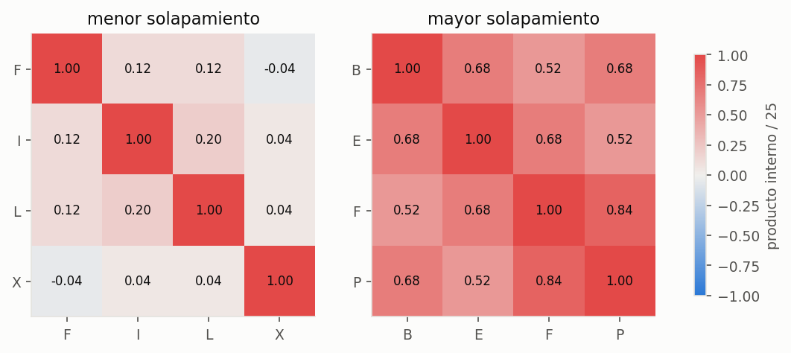
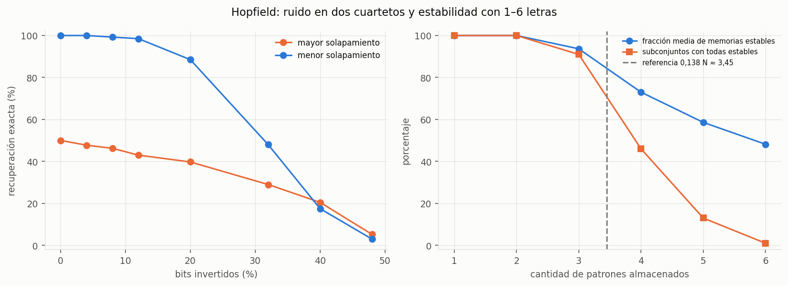
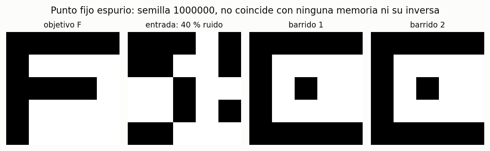
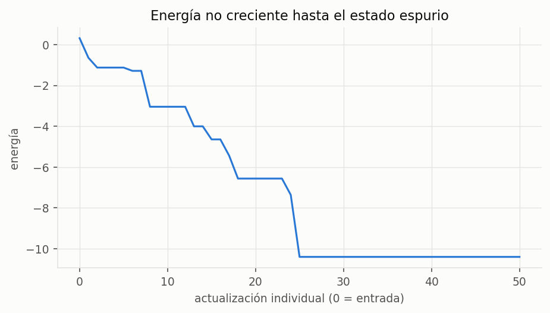

# Ejercicio 2.2 · Hopfield con letras 5×5

Primera parte del ejercicio 2; los códigos QR se abordan después.
Modelo: `models/hopfield.py`. Experimento: `python letras.py`, desde `TP4/`, con las
dependencias de `requirements.txt`. No se agregaron dependencias.

## Representación y modelo

Se definen 16 letras candidatas de 5×5 en `letras.py`: A, B, C, E, F, H, I, J, L, O, P,
T, U, X, Y y Z. Cada trazo vale +1 y cada fondo −1. J reproduce el patrón del enunciado.
Los vectores de 25 neuronas se guardan en [patrones.npz](patrones.npz) y se muestran en
[patrones.png](patrones.png). El resultado depende de estas tipografías discretas.

El aprendizaje es Hebb: `W = Σ ξᵐ (ξᵐ)ᵀ / N`, con diagonal cero. Los pesos son simétricos.
La recuperación es **asincrónica**: cada barrido recorre una permutación aleatoria de las
25 neuronas y cada actualización usa el estado ya modificado. Se aplica el signo del campo
local; si es cero, se conserva el bit. No se entrena por épocas ni se ajusta una tasa de
aprendizaje: almacenar las memorias consiste en construir W.

Se registra `E(s) = −½ sᵀ W s` después de cada actualización individual. Para una neurona,
`ΔE = −Δsᵢ hᵢ`; el cálculo incremental se contrastó con el cálculo completo en las pruebas.
Un barrido sin cambios certifica un punto fijo. El límite es 100 barridos; si se alcanza,
se comprueba igualmente la estabilidad. En estas corridas todas las consultas convergieron.
Los barridos informados incluyen el barrido sin cambios que confirma la parada.
La formulación de memoria asociativa y su interpretación mediante energía se basan en
[Hopfield (1982)](https://www.dna.caltech.edu/courses/cs191/paperscs191/Hopfield82.pdf).

## Ortogonalidad: elegir cuatro letras

Se enumeraron los **1.820 cuartetos** de las 16 letras y se ordenaron por la media de
`|ξᵢ·ξⱼ|/25` sobre sus seis pares. Se eligieron los extremos antes de observar su recuperación:

| Grupo | Letras | Solapamiento absoluto medio | Máximo absoluto |
|---|---|---:|---:|
| Menor solapamiento | F, I, L, X | 0,0933 | 0,20 |
| Mayor solapamiento | B, E, F, P | 0,6533 | 0,84 |

La selección es relativa a este banco de letras y a este criterio, no un óptimo universal.
Los empates se ordenan alfabéticamente; se toma la primera fila para el mínimo y la última
para el máximo. No se eligió el grupo por su porcentaje de acierto.

Los productos internos están en [productos_internos.csv](productos_internos.csv), sus
versiones normalizadas en [solapamientos.csv](solapamientos.csv), y el barrido completo
en [cuartetos.csv](cuartetos.csv). Para FILX los seis productos son 3, 3, −1, 5, 1 y 1;
para BEFP son 17, 13, 17, 17, 13 y 21. Como N = 25 es impar, la suma de 25 términos ±1
no puede dar cero: no puede haber ortogonalidad exacta entre estos vectores bipolares.

## Estabilidad y ruido

Primero se consultan las letras sin alterar. En FILX las cuatro son puntos fijos.
En BEFP solo F y P lo son: B y E terminan con un bit cambiado, demostrando interferencia
entre memorias aun sin ruido. Se guarda la comprobación en [estabilidad.csv](estabilidad.csv).

Luego se invierten exactamente 0, 1, 2, 3, 5, 8, 10 o 12 bits, seleccionados sin reemplazo.
Son 100 repeticiones por letra y nivel: 400 ensayos por grupo y nivel, **6.400 corridas**
en total. Las semillas se determinan a partir del nivel, posición de la letra y repetición,
con las mismas posiciones de ruido y órdenes de actualización para ambos grupos.
El nivel cero repite la consulta sin ruido: sus 400 corridas no representan 400 patrones
de entrada distintos.

| Bits invertidos | Ruido real | Recuperación exacta FILX | Recuperación exacta BEFP |
|---:|---:|---:|---:|
| 0 | 0 % | 100 % | 50 % |
| 1 | 4 % | 100 % | 47,75 % |
| 2 | 8 % | 99,25 % | 46,25 % |
| 3 | 12 % | 98,50 % | 43 % |
| 5 | 20 % | 88,50 % | 39,75 % |
| 8 | 32 % | 48 % | 29 % |
| 10 | 40 % | 17,50 % | 20,50 % |
| 12 | 48 % | 3 % | 5,25 % |

Las etiquetas distinguen recuperación exacta de la letra objetivo, otra memoria,
inverso de una memoria, punto fijo espurio y límite sin convergencia. Un inverso se
cuenta como fallo, aunque también pueda ser un atractor por la simetría sin umbrales.
En [recuperacion.csv](recuperacion.csv) están todas las corridas; el
[resumen](recuperacion_resumen.csv) incluye distancias finales y barridos medios.

FILX resiste mejor ruido bajo y moderado; a ruido alto ninguno es fiable. El mayor
solapamiento no empeora necesariamente cada porcentaje de la tabla: en 40 % y 48 %
BEFP supera levemente a FILX, con aciertos bajos en ambos. El resultado depende de las
cuencas de atracción y de las muestras, no solo de la media de productos internos.

## Capacidad: estabilidad al aumentar las memorias

Se almacenan entre 1 y 6 letras de las 16 candidatas. Para cada tamaño se prueban hasta
100 subconjuntos uniformes sin reemplazo, con semilla 0; para una memoria se prueban las
16 posibilidades. Cada subconjunto genera una red nueva. Se evalúa si los patrones
originales son puntos fijos, sin añadir ruido en este experimento.

| Memorias | Subconjuntos evaluados | Fracción media de memorias estables | Subconjuntos con todas estables |
|---:|---:|---:|---:|
| 1 | 16 | 100 % | 100 % |
| 2 | 100 | 100 % | 100 % |
| 3 | 100 | 93,67 % | 91 % |
| 4 | 100 | 73 % | 46 % |
| 5 | 100 | 58,60 % | 13 % |
| 6 | 100 | 48,17 % | 1 % |

La referencia sugerida en TAREAS.md, `0,138 N ≈ 3,45`, se muestra como orientación.
El orden de magnitud proviene de análisis de redes grandes con patrones aleatorios;
no garantiza recuperación exacta de cualquier colección de letras en N = 25.
El estudio original analiza el límite con `p = αN`
([Amit, Gutfreund y Sompolinsky, 1985](https://doi.org/10.1103/PhysRevLett.55.1530));
el valor cercano a 0,138 aparece en el análisis de
[Steffan y Kühn (1994)](https://arxiv.org/abs/cond-mat/9404036).

Aquí almacenar cuatro letras puede funcionar con FILX y fallar con BEFP. Los porcentajes
de la tabla describen **estabilidad exacta de estas letras**, no una estimación del umbral
asintótico ni del tamaño de las cuencas de recuperación. Las observaciones están en
[capacidad.csv](capacidad.csv) y [capacidad_resumen.csv](capacidad_resumen.csv).

## Un estado espurio verificable

Se usa la red FILX. La búsqueda es determinista: prueba consultas con 10 bits invertidos
(40 %) y semillas desde 1.000.000 hasta encontrar un punto fijo que no coincida con
ninguna memoria ni con sus inversas. No se restringe su forma a una mezcla particular.

El primer ensayo ya lo encuentra: objetivo **F**, semilla **1.000.000**.
Tras el primer barrido alcanza el estado; el segundo lo confirma sin cambios.
Las distancias finales a F, I, L y X son **6, 5, 5 y 13 bits**, respectivamente.
La energía baja de **0,32 a −10,40**. Todos los productos `sᵢ hᵢ` son positivos
(mínimo 0,32): es un mínimo local estricto ante cambios de un bit, no un empate numérico.

[espurio.npz](espurio.npz) guarda memorias, pesos, entrada, salida, estados por barrido,
energías, semilla y letra objetivo. [energia_espurio.csv](energia_espurio.csv) registra
los 51 valores de energía: entrada más 2 × 25 actualizaciones. Que la red converja y la
energía disminuya **no implica recuperar la memoria consultada**.

## Verificación y siguiente parte

`python -m unittest discover -s tests -v` ejecuta seis pruebas del modelo: Hebb simétrica
con diagonal nula, corrección de errores para una memoria, energía no creciente y su
cálculo incremental, empates, estabilidad de patrones inversos y validación de entradas.
Además, el experimento verifica energía no creciente en las 6.400 consultas.
Se inspeccionaron los gráficos generados.

Queda completo el caso sencillo 2.2. El siguiente paso es aplicar la misma red a los cinco
QR de 37×37: comprobar primero su estabilidad con Hebb y después estudiar recuperación,
energía e iteraciones con diferentes deterioros. Estos resultados con letras no anticipan
el porcentaje de recuperación de los QR.
