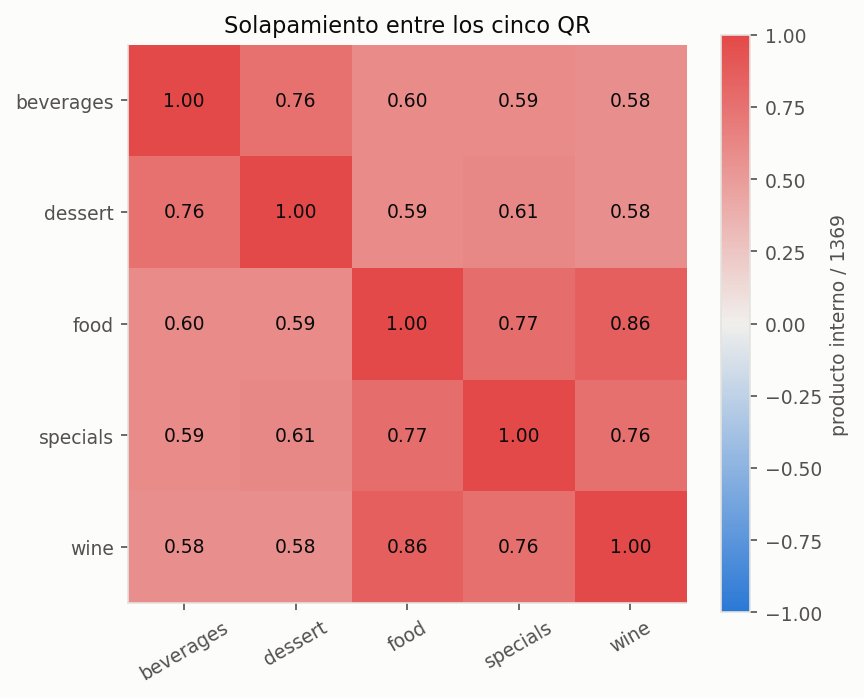
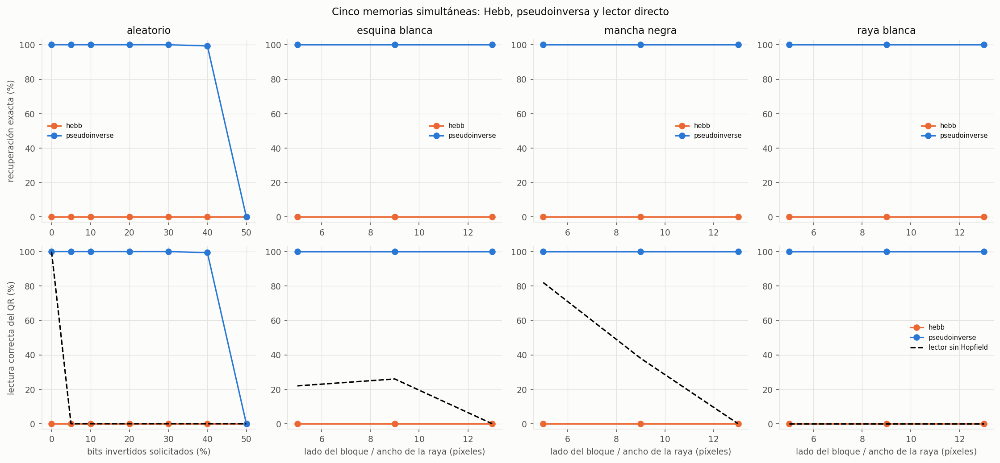
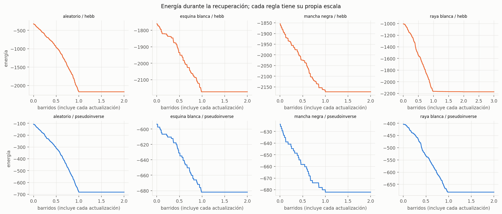
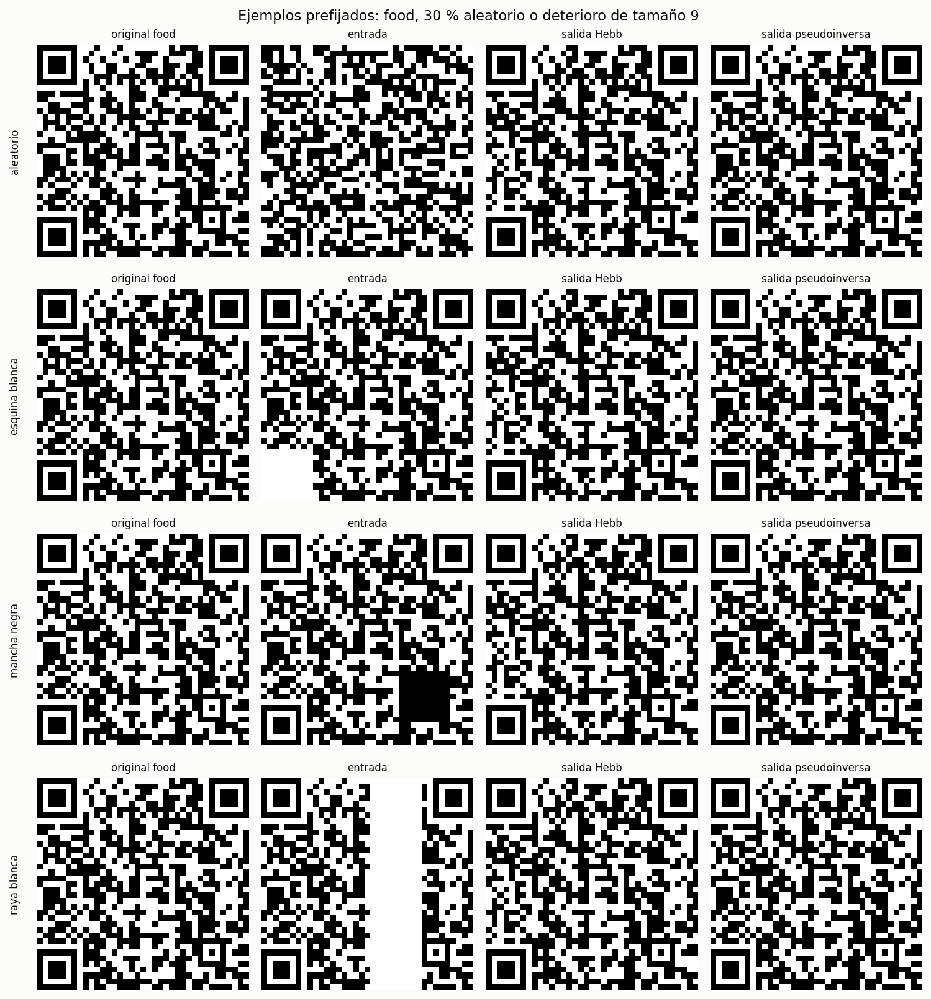

# Ejercicio 2.1 · Recuperación de los QR de Trattoria Aurora

Experimento: `qr.py`; modelo compartido con las letras: `models/hopfield.py`.
Se mantiene **Hebb como caso principal** y se compara una mejora opcional por pseudoinversa.
Los CSV y gráficos se generan con el script; este informe se redactó a partir de esas salidas.

## Representación y protocolo

Se cargan los cinco PNG originales: beverages, dessert, food, specials y wine. Cada imagen
ya es binaria de 37×37. Negro se representa por −1 y blanco por +1; se aplana a un vector
de **N = 1.369 neuronas**. Se almacenan los cinco vectores en la misma red.
No se modifica el dataset ni se amplía la imagen antes del entrenamiento.

La dinámica es la misma de las letras: actualizaciones asincrónicas en orden aleatorio,
campo cero conserva el estado, diagonal de W nula y parada al completar un barrido sin
cambios. El máximo es 100 barridos; todas las consultas de este experimento convergieron
en cinco o menos. Un barrido equivale a 1.369 actualizaciones individuales, incluidas las
que no cambian el bit. La energía se registra después de cada actualización.

Se comparan consultas idénticas y semillas idénticas para ambas reglas. Se mide:

- Igualdad exacta de la salida con la memoria objetivo y distancia de Hamming final.
- Llegada a otra memoria, su inversa o un estado espurio.
- Energía y barridos hasta la parada.
- Lectura de la URL correcta tanto antes como después de Hopfield.

Para el lector se agregan cuatro módulos blancos de borde y se amplía ×8 sin interpolación,
obteniendo PNG de 360×360. Se usa **ZXing-C++ 3.1.1**; el paquete solamente verifica la
salida, no aprende pesos ni participa de la recuperación. Su API está documentada por
[el proyecto ZXing-C++](https://github.com/zxing-cpp/zxing-cpp/blob/master/wrappers/python/README.md).
Los cinco originales se leyeron correctamente y sus textos se conservaron en
[textos_originales.csv](textos_originales.csv). Se compara el texto completo con el original,
no solamente que el lector detecte un QR. No se visitan las URLs.

## Antes del ruido: Hebb ya tiene interferencia

Los cinco QR comparten **955 de 1.369 píxeles (69,76 %)**. Sus solapamientos normalizados
entre pares están entre **0,576 y 0,860**; food y wine tienen el mayor.
El detalle está en [solapamientos.csv](solapamientos.csv).



Con `W = XᵀX/N` y diagonal cero, ninguno de los cinco originales es punto fijo:

| QR consultado sin ruido | Bits distintos al terminar | Barridos |
|---|---:|---:|
| beverages | 225 | 2 |
| dessert | 225 | 2 |
| food | 71 | 2 |
| specials | 103 | 2 |
| wine | 91 | 2 |

Las cinco consultas sin ruido terminan en el mismo estado espurio. La estructura compartida
domina el aprendizaje y se pierde la información que distingue menús. Como control,
**cada QR sí es estable si se almacena solo con Hebb**: no se trata de una falla de la
implementación. Ver [estabilidad.csv](estabilidad.csv).

Tener 1.369 neuronas y solo cinco memorias no basta para garantizar recuperación. La
referencia de capacidad para patrones aleatorios poco correlacionados no se puede aplicar
directamente a estos QR, cuya estructura es compartida. Este es el principal límite del
caso propuesto con Hebb.

## Ruido aleatorio

Se invierten exactamente `round(fracción × 1369)` bits, elegidos sin reemplazo. Hay
30 repeticiones por QR y nivel: **150 consultas por regla y nivel**, con siete niveles.
Son 2.100 recuperaciones contando ambas reglas. En nivel cero se repiten consultas sin
ruido: no son 150 patrones originales distintos. Los porcentajes siguientes son resultados
empíricos de estas semillas, no garantías para cualquier deterioro.

| Nivel solicitado | Bits invertidos | Hebb: exacto | Pseudoinversa: exacto | Lector directo: URL correcta |
|---:|---:|---:|---:|---:|
| 0 % | 0 | 0 % | 100 % | 100 % |
| 5 % | 68 | 0 % | 100 % | 0 % |
| 10 % | 137 | 0 % | 100 % | 0 % |
| 20 % | 274 | 0 % | 100 % | 0 % |
| 30 % | 411 | 0 % | 100 % | 0 % |
| 40 % | 548 | 0 % | 99,33 % (149/150) | 0 % |
| 50 % | 684 | 0 % | 0 % | 0 % |

El único fallo al 40 % fue `food`, repetición 7, semilla 50.207: la red llegó a la
memoria `wine`, a 96 bits de la original, en cuatro barridos. El lector obtuvo una URL
válida pero de otro menú. Por eso se compara siempre el texto con la memoria objetivo.

La fracción real puede diferir ligeramente de la solicitada por el redondeo a bits enteros.
En estos ensayos, el porcentaje de lectura correcta después de cada regla coincide con
su recuperación exacta. Esto es un resultado observado, no una equivalencia general entre
legibilidad e igualdad de píxeles. Con daño localizado el lector puede leer una entrada
que no es idéntica al original.

## Deterioros localizados

Se prueban tres tipos de deterioro para cada QR, con diez repeticiones por nivel y niveles
5, 9 y 13. Son **50 consultas por regla y condición** y 900 recuperaciones adicionales:

- **Esquina blanca:** bloque de lado 5, 9 o 13, en una de las cuatro esquinas.
- **Mancha negra:** bloque de esos lados, ubicado al azar.
- **Raya blanca:** franja horizontal o vertical de ancho 5, 9 o 13, ubicada al azar.

Pintar un bloque no invierte todos sus bits: los píxeles que ya tenían ese color no cambian.
Por eso el CSV registra por separado superficie afectada y cantidad de bits modificados.
Un píxel borrado se representa como blanco; no es una tercera categoría «desconocido» y
no se informa la máscara del daño a Hopfield.

| Deterioro | Tamaño | Bits modificados, media del total | Lector directo | Hebb: exacto | Pseudoinversa: exacto |
|---|---:|---:|---:|---:|---:|
| Esquina blanca | 5 | 1,25 % | 22 % | 0 % | 100 % |
| Esquina blanca | 9 | 3,24 % | 26 % | 0 % | 100 % |
| Esquina blanca | 13 | 6,80 % | 0 % | 0 % | 100 % |
| Mancha negra | 5 | 0,93 % | 82 % | 0 % | 100 % |
| Mancha negra | 9 | 2,82 % | 38 % | 0 % | 100 % |
| Mancha negra | 13 | 6,09 % | 0 % | 0 % | 100 % |
| Raya blanca | 5 | 6,91 % | 0 % | 0 % | 100 % |
| Raya blanca | 9 | 12,44 % | 0 % | 0 % | 100 % |
| Raya blanca | 13 | 17,91 % | 0 % | 0 % | 100 % |

El lector no empeora necesariamente de forma monótona en una muestra pequeña: el 22 % y
26 % de esquinas distintas no implica que un daño mayor ayude. Importan la localización,
el contenido alterado y las semillas. El ruido independiente tampoco equivale al daño
localizado, aunque se modifique una fracción parecida de bits.



## Mejora opcional: pseudoinversa

Se reemplaza únicamente la construcción de pesos por la proyección
`P = Xᵀ (XXᵀ)⁺ X` y se anula la diagonal. El resto de la dinámica y las consultas son
idénticos. La pseudoinversa se calcula con NumPy; no se delega la red a una librería de
aprendizaje. La regla de proyección se estudia en
[Kanter y Sompolinsky (1987)](https://doi.org/10.1103/PhysRevA.35.380).

Para estos cinco patrones linealmente independientes, `Pξ = ξ`. Al quitar la diagonal,
el campo en un patrón es `(1 − Pᵢᵢ)ξᵢ`: aquí mantiene su signo y las cinco memorias quedan
estables. Eso explica la mejora frente a la interferencia de Hebb; **no prueba** que cualquier
consulta ruidosa llegue a la memoria correcta. La caída cerca del 50 % de ruido y el fallo
a 40 % muestran la diferencia entre estabilidad y tamaño de la cuenca de atracción.

La pseudoinversa se presenta como extensión separada. El resultado del modelo clásico
pedido sigue siendo que Hebb no recupera correctamente este conjunto de QR.

## Iteraciones y energía

En Hebb, las medias por condición quedan entre **2 y 2,97 barridos**, con máximo 3.
En pseudoinversa, los originales requieren uno; los casos aleatorios hasta 30 % requieren
dos, el 40 % promedia 2,13 (máximo 4) y el 50 % promedia 2,90 (máximo 5).
Dos barridos corresponden a 2.738 actualizaciones; el segundo puede ser únicamente la
confirmación sin cambios.

Se verificó que la energía no aumenta en **las 3.000 recuperaciones**. Convergencia no es
sinónimo de recuperación: Hebb también disminuye su energía y llega a un estado incorrecto.
Cada regla define pesos y escalas de energía diferentes; no se compara «más negativo» entre
reglas como indicador de calidad.



Los ejemplos se fijan antes de ver sus resultados: food con 30 % aleatorio y con daño de
tamaño 9 de cada tipo, repetición 0. Las consultas, estados y energías individuales se
guardan en los ocho archivos `ejemplo_*.npz`. La tabla
[energia_por_barrido.csv](energia_por_barrido.csv) conserva los valores al final de cada
barrido de todas las corridas; las curvas de los ejemplos incluyen cada actualización.



## Límites y uso práctico

- Solo se busca recuperar **QR previamente almacenados**. La red no crea el menú ni deduce
  la URL de un QR nuevo; una consulta desconocida también puede terminar en un atractor.
- La correlación es decisiva: aumentar N no elimina la interferencia de Hebb entre estos QR.
- Persisten estados espurios, inversos y errores hacia otra memoria. Converger o tener baja
  energía no certifica el menú correcto. Un lector que detecte «algún QR» tampoco lo certifica.
- Se trabajó sobre módulos ya alineados y binarios. Una foto requeriría localizar el código,
  corregir perspectiva, iluminación y escala; esos pasos no se implementaron.
- Los resultados corresponden a cinco QR y a los deterioros definidos. No son una garantía
  de recuperar cualquier rotura ni una estimación de rendimiento fuera de este conjunto.
- La matriz densa tiene 1.874.161 coeficientes, unos 15 MB en float64 por modelo. Ampliar
  píxeles antes de entrenar aumentaría mucho el costo; la ampliación se usa solo para leer.
- Si el QR ya se lee, el lector directo puede ser suficiente. Hebb incluso arruina los
  originales; por eso no debe aplicarse automáticamente como «reparación».

## Reproducción y archivos

Desde `TP4/`, con el entorno activado:

```bash
python -m pip install -r requirements-qr.txt
OPENBLAS_NUM_THREADS=1 python qr.py
OPENBLAS_NUM_THREADS=1 python -m unittest discover -s tests -v
```

La variable de BLAS limita hilos para evitar sobrecosto en las operaciones pequeñas y
repetidas; no cambia el algoritmo. Los PNG se guardan en esta carpeta. `lector/` contiene
originales, entradas y salidas de los ejemplos con borde y escala, listos para otro lector.

`recuperacion.csv` tiene las 3.000 corridas, y [resumen.csv](resumen.csv) las 32 condiciones
regla/tipo/nivel. `modelo_hebb.npz` y `modelo_pseudoinverse.npz` conservan pesos, memorias,
nombres y regla. Pasaron doce pruebas: las del modelo y controles de carga/lectura de QR,
ruido reproducible, diferencia entre área pintada y bits alterados, y estabilidad de patrones.
